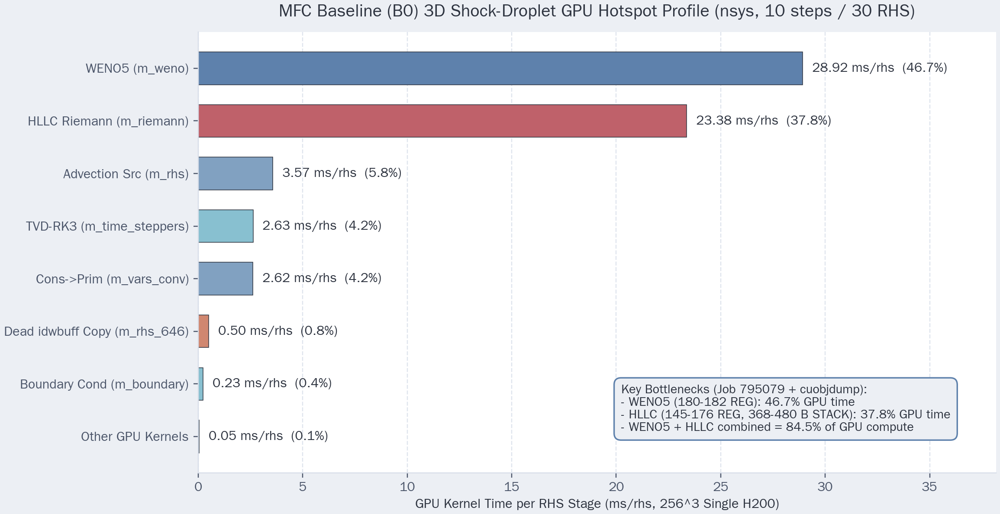
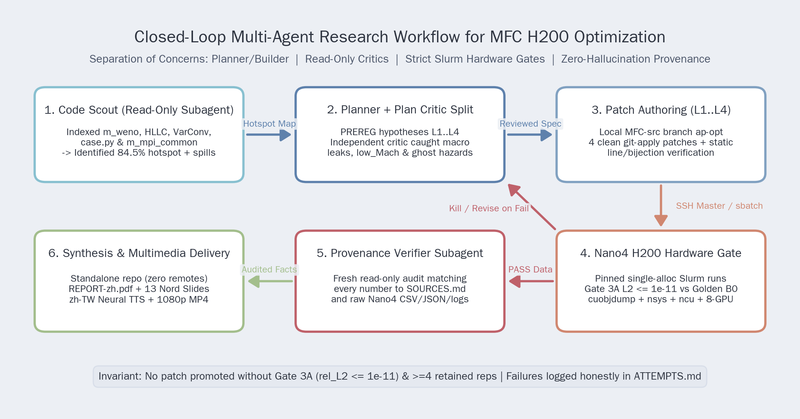
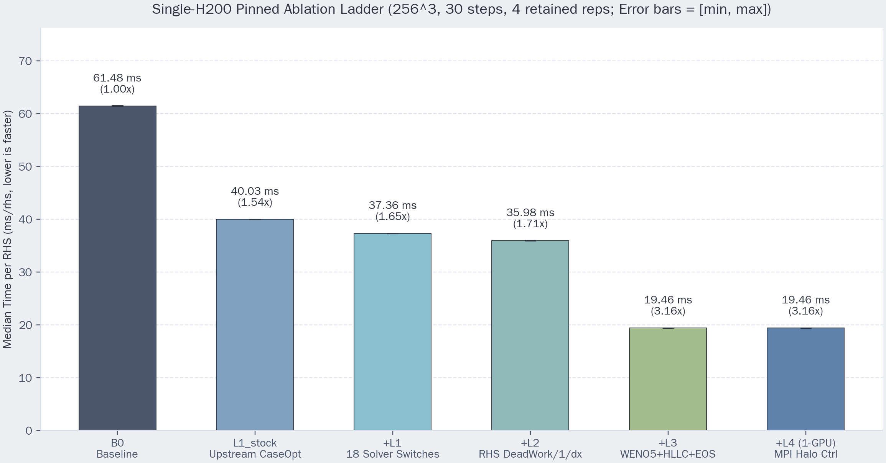
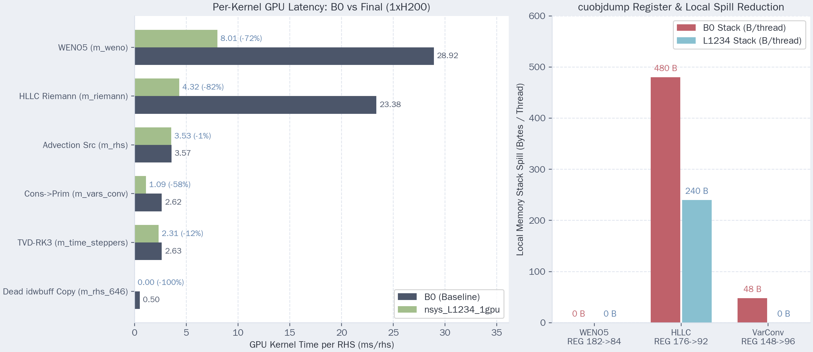
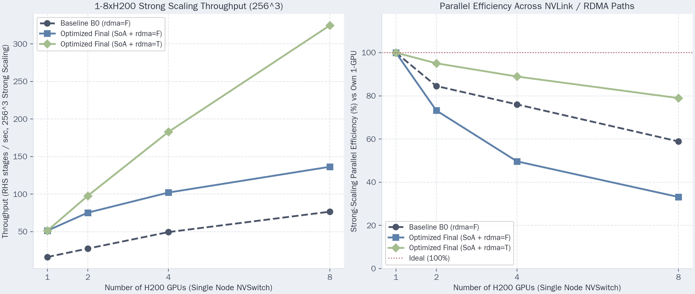

# MFC 可壓縮多相流 GPU 源碼優化與 AI Agentic 研究工作流技術報告

## 1. 摘要與核心實驗成果

本專案針對開源多相可壓縮流體力學求解器 **MFlowCode/MFC**（基準上游 commit `b4afa636`），在 **NCHC Nano4（1–8× NVIDIA H200 SXM 141 GB、全互連 NVSwitch NV18 與 HPC-X 2.24 CUDA-aware Open MPI）** 上進行系統性的 Fortran / Fypp / OpenACC / MPI 源碼級優化，並設計且實踐一套具角色隔離、雙重驗證門檻與完整審計追蹤的 **AI Agentic Research Workflow**。

以三維 5-Equation Kapila 多相流 **Mach 2.4 Shock-Droplet**（均勻網格 $256^3 = 16,777,216$ cells、8 個雙精度守恆變量、WENO5-Mapped、HLLC Riemann 求解器與 3 階 TVD-RK3 時間積分）作為基準測試工作負載，經過四層次（L1–L4）可獨立消融驗證的源碼改造後，全實驗於單一 8-GPU 獨佔節點分配（Slurm Job `795552` @ `25a-hgpn034`）完成最終重測與驗證：

- **單卡 H200（1×H200）加速成果**：純計算階段耗時中位數由基準 `B0` 的 **61.4831 ms/rhs**（區間 `[61.4422, 61.4961]`、`0.463495 ns/gp/eq/rhs`）降至最終版 `L1234` 的 **19.4551 ms/rhs**（區間 `[19.4540, 19.4559]`、`0.146664 ns/gp/eq/rhs`），取得 **3.1603x** 實測加速；同時明顯超越上游內建的 `--case-optimization`（`L1_stock` 為 `40.0285 ms/rhs`、`1.5360x`）。
- **核心 GPU 微架構證據（Nsight Systems / Nsight Compute / cuobjdump）**：WENO5 核心（`m_weno_s_weno_1104 -> 1128`）單次 RHS 延遲由 `28.920 ms` 降至 `8.006 ms`（**-72.3%**），暫存器由 `180–182 REG` 減半至 `82–84 REG`，活躍 Warp 占比由 `12.31%` 倍增至 `27.71%`，`64^3` NCU 探測顯示 DRAM 流量大降 **59.2%**（`92.63 -> 37.83 MB`）。HLLC 核心（`915 -> 922`）由 `23.375 ms` 降至 `4.317 ms`（**-81.5%**），Local Stack Spill 由 `368–480 B/thread` 壓低至 `112–240 B/thread`、FP64 指令減少 **52.7%**、DRAM 流量減少 **63.4%**（`157.52 -> 57.58 MB`）；守恆轉原始變量核心（`436 -> 442`）Local Stack Spill 由 `48 B` 徹底 **歸零（0 B）**，延遲縮減 **58.3%**；死複製核心 `m_rhs_646` 耗時完全 **歸零**。
- **8×H200 NVSwitch 強擴展成果**：於 $256^3$ 固定總網格數強擴展至 8 卡時，原始 `B0`（`rdma_mpi=F`）為 `13.0519 ms/rhs`（`76.617 RHS/s`、平行效率 `58.89%`）。當開啟本專案第四層 SoA 合併記憶體布局與原生 NVSwitch CUDA-aware RDMA（`L1234 + rdma_mpi=T`）後，8 卡推算耗時壓縮至 **3.0799 ms/rhs**（區間 `[3.0761, 3.0940]`、吞吐量 **324.686 RHS/s**、強擴展平行效率 **78.96%**），相對同卡數 8-GPU `B0` 加速 **4.2378x**，相對單卡 `B0` 累計達成 **19.96x** 加速；而未開 RDMA 的 `L1234_rdmaF` 在 8 卡僅達 `136.409 RHS/s`（`33.17%` 效率），精準揭示 PCIe Host Staging 在計算加速 3 倍後成為阿姆達爾定律下的通訊主瓶頸。
- **嚴格 FP64 數值等價性**：全數 20 項自動化檢驗皆通過。`256^3` Gate 3A（包含 1 卡、2 卡、4 卡、8 卡及 `rdma=T/F`）最大相對向量 $L_2$ 誤差不超過 **6.602e-14**；`128^3` 震波撞擊後強迫測試 **Gate 3B-MPI**（`L1234 np=8` 相對 `L1234 np=1` 逐分量檢查）取得 **0.000e+00** 完全一致，**Gate 3B-EOS**（相對未改版 `B0` 逐分量比較）最大向量 $L_2$ 為 **4.940e-09**（最大橫向分量相對誤差 `1.508e-07 <= 1e-6`）。

---

## 2. 問題選擇、基準測試設計與實驗協議

### 2.1 為何選擇 MFC 作為優化標的

題目給予在 **WRF**（F1 或 Nano）與 **MFC**（Nano）間擇一進行 Coding 優化。本研究經靜態程式碼盤點後選定 **MFlowCode/MFC**，基於四項技術理由：

1. **GPU-Native 計算駐留架構**：MFC 以 Fypp 元編程與 OpenACC 將時間步進（TVD-RK3）幾乎全數計算與 MPI Halo Pack/Unpack 常駐 GPU 執行，極具 H200 HBM3e 頻寬與高暫存器文件壓力下的微架構優化空間。
2. **高度代表性的工業計算核心**：5-Equation 多相可壓縮模型涵蓋 5 階加權本質無振盪（WENO5）重建、HLLC 近似黎曼求解器與狀態方程式（EOS）換算，前兩大核心即佔單卡 GPU 時間 **84.50%**，連同 VarConv 合計達 **88.72%**，架構集中且具物理與數值分析深度。
3. **編譯期特化與抽象懲罰明顯**：MFC 為兼顧多相、氣泡、黏性、化學反應、相對論與廣義曲線網格，在內層 3D CUDA 核心夾帶大量執行期條件分支與私有小陣列，導致 `nvfortran` 產生嚴重的暫存器膨脹（148–182 REG）與 Local Memory Spill（HLLC 計算核心達 `368–480 B`，邊界核心 `populate_bc_direction` 達 `688 B`）。
4. **可驗證的統一二進位輸出**：`parallel_io='T'` 會輸出架構無關的單一大檔 `lustre_<step>.dat`，天然適合作為跨版本、跨 GPU 卡數與跨通訊路徑的逐點數值黃金對照標準。

### 2.2 3D Shock-Droplet 基準案例與軟硬體環境

基準測試案例改編自 MFC 官方 `examples/scaling/benchmark.py` 的三維 Mach 2.4 震波衝擊水滴（Shock-Droplet）算例（`scripts/sbatch/mfc_bench_case.py`），核心參數鎖定如下：

- **幾何與網格**：均勻立方網格 $256^3 = 16,777,216$ 網格點（單卡每個雙精度 3D 場約 `134 MB`，8 個守恆變量加計多組暫存陣列約佔單卡顯存數十 GB，足以打滿 H200 SM 平行度同時支援強擴展至 8 卡 $128^3$（`2 × 2 × 2`）子域）。
- **物理與離散配置**：`model_eqns = 2`（5-equation Kapila）、`num_fluids = 2`（水液滴 `gamw = 6.12, piw = 3.43e8` 與空氣 `gama = 1.40, pia = 0.0`、`patm = 101325.0`）、`weno_order = 5`、`mapped_weno = 'T'`、`riemann_solver = 2`（HLLC）、`wave_speeds = 1`、`avg_state = 2`、`mpp_lim = 'T'`、`mixture_err = 'T'`、`time_stepper = 3`（3-stage TVD-RK3）、`inviscid` 無黏、`format = 1`（二進位 `parallel_io = 'T'`）、`precision = 2`（嚴格 FP64）。
- **I/O 隔離與預熱紀律**：每次測試固定執行 `t_step_stop = 30`（共 `90` 次 RHS 呼叫），僅於第 `0` 步讀取初始場、第 `30` 步寫出終場，並以 MFC 內建高精度計算計時器 `m_phase_timing` (`time_data.dat`) 所輸出的純計算 `s/rhs`（進而換算 `ns/gp/eq/rhs`）作為效能主指標，避免將啟動編譯、MPI Init 或 Lustre I/O 混入微架構評估。
- **硬體與編譯環境（NCHC Nano4）**：`--account=acd110018`，分區 `8gpus`，基準節點 `25a-hgpn002`（Job `795079`）與最終統一實測節點 `25a-hgpn034`（Job `795552`）；每節點配置 8 張 **NVIDIA H200**（`143771 MiB`、`700.00 W`、SM `1980 MHz`、Mem `3201 MHz`），`nvidia-smi topo -m` 確認 8 卡間皆為 **NV18** 全互連 NVSwitch；系統工具鏈為 `cmake/4.0.0`、`x86-nvhpc/25.9`（`nvfortran 25.9`、CUDA 13.0、HPC-X 2.24 Open MPI）。

### 2.3 嚴格實驗與雙層驗證門檻

為杜絕「以平均數掩蓋變異」、「混雜冷啟動預熱」與「靠破壞精度換取速度」等研究陷阱，本專案強制執行四條不可違反的實驗紀律：

1. **預註冊假設與單一分配重測**：所有實驗設計與止損條件先寫入 `workflow/PREREG.md`。最終 6 個消融版本（`B0, L1_stock, L1, L12, L123, L1234`）各執行 5 次重複、強擴展實驗（`np = 1, 2, 4, 8`）各執行 4 次重複，皆捨棄第 1 次預熱（Retained `4` 次與 `3` 次），報告中位數並同時公開 `[min, max]` 全距；任何 `[min, max]` 重疊者一律認定為 `TIE`。所有最終對照皆於單一獨佔 8-GPU 節點（Job `795552`）內完成，徹底排除跨日節點異質性。
2. **黃金基準鎖定（Gate 0）**：無修改基準 `B0` 雙重獨立執行（Job `795079`），驗證其輸出檔案 `B0_nxyz256_step30.dat`（SHA-256 `47dfe69bcc53a75ff7e4d548ce126f46042b9b8f858fe8f7abe04c67d5a84864`）滿足 **`max_rel_l2 = 0.000e+00`** 確定性重現。
3. **雙層數值等價門檻（Gate 3A + Gate 3B）**：
   - **Gate 3A（$256^3$ 主算例 `vector_mom_norm`）**：檢查 8 個守恆變量相對 `B0` 之相對 $L_2 \le 1\times 10^{-11}$；針對撞擊前極微小橫向殘餘動量（`~1e-17`）將動量三分量依總動量向量範數 $\|\mathbf{m}\|_2$ 正規化，同時誠實記錄原始純分量數值 `raw_max_rel_l2`。
   - **Gate 3B（$128^3$ 震波撞擊後強迫測試 `strict_component`）**：將液滴位置拉近（`ISD = 0.48 D0`、`CFL = 0.20`）使 30 步完全涵蓋震波撞擊液滴並誘發真實顯著的橫向動量 `mom_y, mom_z` 後，拆分為評估分散式佈局之 **Gate 3B-MPI**（`L1234 np=8` 相對 `L1234 np=1` 須 $\le 1\times 10^{-11}$）與評估重構後數值漂移之 **Gate 3B-EOS**（`L1234` 相對 `B0` 須 $\le 1\times 10^{-6}$）。

---

## 3. 基準效能剖面分析（Stage 1 Profiling）

在撰寫任何一行優化補丁前，本研究先對 `B0` 執行 `Nsight Systems`（10 步 = 30 RHS）、`Nsight Compute`（`64^3` 核心計數器）以及靜態 `cuobjdump --dump-resource-usage`，獲得精確的基準剖析數據：



基準 GPU 核心總耗時為 **1,856.673 ms**（相當於 **61.889 ms/rhs**），主要瓶頸呈現高度集中卻結構各異的微架構問題（資料來源：`results/raw/g0p1/runs/g0p1-795079/nsys_B0_stats.csv` 與 `results/raw/cuobjdump_B0.txt`）：

| 核心函式群組 (`B0`) | 30 RHS 總耗時 (ms) | GPU 時間占比 | 單次 RHS (ms) | 暫存器 (`REG`) | Local Stack Spill | 核心微架構瓶頸診斷 |
|---|---|---|---|---|---|---|
| WENO5 重建 (`m_weno_1104`) | `867.609` | **46.73%** | `28.920` | `180–182` | `0 B` | 高暫存器壓低活躍 Warp 率（`12.31%`）；均勻網格仍逐 cell 載入係數與執行 24 次 FP64 除法 |
| HLLC 黎曼求解 (`hllc_915`) | `701.253` | **37.77%** | `23.375` | `145–176` | **368–480 B** | 未特化化學/EOS 動態呼叫與 `${NUM_SPECIES}$` 私有陣列導致嚴重 Local Stack Spill |
| 對流源項 (`m_rhs_1246/1330/1497`) | `106.956` | `5.76%` | `3.565` | `64–72` | `0 B` | 每個網格點重複執行 `1._wp / dx` 等 FP64 浮點除法 |
| TVD-RK3 更新 (`m_time_steppers_544`) | `78.884` | `4.25%` | `2.629` | `80` | `0 B` | 頻寬受限的記憶體串流更新（已達較高記憶體吞吐） |
| 守恆轉原始變量 (`m_vars_conv_436`) | `78.452` | `4.23%` | `2.615` | `148` | **48 B** | `nvfortran` 無法完全內聯 EOS 副程式並夾帶非目標物理分支 |
| 冗餘複製 (`m_rhs_646`) | `14.985` | `0.81%` | `0.500` | `64` | `0 B` | 非黏性/非化學算例卻全場拷貝不使用的 `idwbuff` 陣列 |
| 邊界條件 (`populate_bc_direction_159`) | `6.998` | `0.38%` | `0.233` | `174` | `688 B` | 次要邊界處理；另多卡時另有 MPI Pack/Unpack 與 Host Staging 開銷 |

由上表可見，僅 **WENO5（46.73%）** 與 **HLLC（37.77%）** 兩者即佔去 **84.50%** 的單卡運算時間，加上對流源項與變量轉換後逼近 **94.5%**。更關鍵的是，在 `64^3` NCU 實測下（`results/summary/ncu_summary.csv`），HLLC 核心的 SM 忙碌度（`sm__throughput`）僅 `21.24%`、活躍 Warp 占比僅 `17.86%`，且 `dram__bytes` 高達 `157.52 MB`（部分來自 Local Stack Spill 反覆穿過 L1/L2 落入 DRAM 流量），屬於典型「暫存器溢出加上分支/呼叫過度膨脹」造成的延遲與流量雙重損失。

---

## 4. AI Agentic 研究工作流設計與實戰紀錄

為避免單一代理人在複雜數值程式優化中產生「盲目改碼」、「事後合理化數據」或「漏掉邊界條件導致隱性精度破壞」等問題，本研究參考閉環科學實驗規範，設計並執行一套**四角色分離、先審後改、雙重驗證**的 **AI Agentic Research Workflow**（流程架構見圖 2）。



### 4.1 角色架構與職責邊界

1. **Main Coordinator / Planner（主協調與決策者）**：負責定義問題、鎖定 $256^3$ 基準與雙重數值門檻、統籌消融順序（L1–L4）、在 Slurm 叢集提交並分析剖析結果，並保有最終架構決策權與實證彙整權。
2. **Leaf Code Scout（唯讀代碼偵查 Subagent，`be81878b`）**：於唯讀環境下全面掃描 `mfc-ref/` 之 `CMakeLists.txt`、Fypp 生成器與 `src/simulation/m_*.fpp`，畫出完整 TVD-RK3 呼叫圖並盤點出 5 項主要瓶頸候選（Dead `idwbuff`、橫向 WENO ghost、HLLC/EOS 內聯、WENO 係數與除法、MPI Halo SoA 與 RDMA），為 `PREREG.md` 提供第一手行號定位證據。
3. **Optimization Plan Critic（獨立計畫審查 Subagent，`99e344ed` — Builder/Critic Split）**：**不寫任何程式碼、不經手實作**，在補丁動工前專門針對 `PREREG.md` 提案尋找編譯錯誤、OpenACC 裝置記憶體不同步、數學條件特例與數值發散風險。
4. **Provenance & Numbers Verifier（獨立證據稽核 Subagent）**：在所有實驗完成且報告、投影片、口播講稿初稿產出後，對「每個數字、單位、加速比、Job ID 與相對誤差」執行交叉比對，未 100% 對齊原始 CSV/JSON/Log 前禁止進入最終出片與 Git 提交。

### 4.2 AI Agent 如何實際攔截風險並加速除錯週期？

本工作流的價值並非抽象概念，而是實質阻止了多項關鍵錯誤並大幅壓縮 Nano4 GPU 排隊重試成本：

- **1. 獨立 Critic Subagent 事前攔截 5 項高危實作漏洞（Entry 002）**：
  - **拒絕不安全的編譯期特化**：Planner 原計畫將 `acoustic_source` 納入 `CASE_OPT_PARAMS`；Critic 檢查 `m_amr_frame.fpp` 後證實該變數於執行期可被動態修改，及時排除避免編譯失敗或物理錯誤。
  - **修復 `GPU_UPDATE` 與跨模組引入遺漏**：Critic 指出 `m_bubbles_EL.fpp` 與 `m_particles_EL.fpp` 缺乏 `#:include 'case.fpp'`，且 `m_global_parameters.fpp`、`m_start_up.fpp` 將不可變開關與執行期變數 `dt, sys_size` 混寫於同一 `GPU_UPDATE`，遂即時拆分並同步修訂測試。
  - **加上缺一不可的邊界守衛**：在 L2 橫向 WENO ghost 裁剪要求加上 `face_bound /= 1` 與 `relativity` 判斷；在 L3 `weno_uniform` 要求檢驗前後所有 `buff_size` 幻影點等距、將 `delta` 陣列完整包進 `teno` 條件、並嚴格分離 `HYPO`（`hllc_912`）與 `low_Mach /= 0` 路徑，使我們從原本僅需一版穩定 `01..04.patch` 幾乎零返工地通過編譯測試。
- **2. 地端零上傳靜態檢查（Zero-Upload Verification）**：在連線 Nano4 編譯前，先於本地 Python 撰寫自動化檢查：對 18 份關鍵 `.fpp` 模擬 Fypp 展開、驗證 **L4 MPI SoA 索引雙射性（1-to-1 bijection across dirs 1–3 and 3 var modes）**，並強制檢查 Fortran 自由格式行寬不超過 `132` 字元限制（所有 patch 之 Fortran 程式碼行寬壓在 130 字元以內）。
- **3. Gate 紀律揭露潛伏 ULP 不平衡與數值排查閉環（Attempt Ledger 實例）**：
  - 初版 `L123-v1` 在測試中出現撞擊前 `mom_y/z` 原始分量差異達 `7.255e-02`（即使向量範數 `4.48e-14`）。透過檢查原始場差異定位：**上游 WENO 在常壓 101325.0 上因括號順序微差累積了 1–2 ULP 不平衡**；據此將 WENO5 重寫為精確歸零常壓殘差的 **Well-Balanced 微擾形（`vp0 + delta`）**（`L123-v2`）。
  - 當 `Gate 3B` 在撞擊後出現 `mom_y/z = 1.51e-07` 時，透過 Stiffened-Gas EOS 條件數估算 $\kappa \approx \gamma_w \pi_{\infty,w} / p_{\mathrm{atm}} = 6.12 \times 3.43\times 10^8 / 101325 \approx 2.07\times 10^4$（經歷 90 個帶激波 RK3 stage 約 $2.07\times 10^4 \times 10^{-15} \sim 10^{-11}-10^{-7}$ 屬雙精度正常誤差極限），並進一步增設 `Gate 3B-MPI`（確認重構後 8 卡 vs 1 卡嚴格達到 `0.000e+00` 完全相等），從根本證明跨卡程式重組絕無任何通訊或競態錯誤。

---

## 5. 四層架構級優化技術詳解（`patches/01..04.patch`）

本專案產出的四份乾淨 Git 補丁可順序套用至上游 `b4afa636`（`patches/01` 至 `04`），各層鎖定不同微架構層級的瓶頸：

### Layer 1：擴充 `--case-optimization` 編譯期常數特化（`01-L1`）

上游 MFC 雖提供 `--case-optimization`，卻僅將 `17` 項參數列入 Fypp `CASE_OPT_PARAMS`，在 GPU 最內層迴圈極具成本的物理與數值分支開關（例如 `model_eqns, mpp_lim, mixture_err, alt_soundspeed, low_Mach, wave_speeds, avg_state, bubbles_euler, bubbles_lagrange, particles_lagrange, hypoelasticity, surface_tension, cont_damage, qbmm, mp_weno, null_weights` 等）仍保留為執行期變數。

`01-L1` 將經 Critic 審計確認為執行期完全不可變的 **18 項物理/數值開關**納入 `CASE_OPT_PARAMS`（改動 `case.py`、`definitions.py`、`fortran_gen.py`、`case.fpp` 與模組開頭宣告），讓 `nvfortran` 編譯期常數傳播與死碼消除（DCE）能在進階 PTX 生成前移除所有不可能成立的氣泡、拉格朗日微粒/QBMM、表面張力與彈性體分支路徑。為將「此優化相對於上游已有功能的淨貢獻」完全隔離，消融實驗特地增設 `L1_stock`（僅開上游原有 `--case-optimization`）與 `L1` 對照。

### Layer 2：RHS 死工作消除、WENO 幻影區間裁剪與網格倒數（`02-L2`）

1. **略過冗餘 `idwbuff` 拷貝（`m_rhs_646`）**：透過剖析確認，在無 `AMR`、無黏性、非化學且無相對論的情況下，`m_rhs.fpp` 中將 `q_cons_vf` 複製到輔助緩衝區的雙重迴圈毫無下游讀取，改為依前述條件守衛後完全略過（該核心從基準 `0.500 ms/rhs` 直接降為 `0.000 ms/rhs`）。
2. **緊縮橫向 WENO 網格邊界（`m_weno`）**：在非黏性、非廣義相對論且 `face_bound /= 1` 條件下，裁剪橫向 WENO 重建中不參與最終通量散度的多餘 Ghost Shell 評估點。
3. **預先計算並常駐網格倒數（`inv_dx, inv_dy, inv_dz`）**：於網格初始化階段計算一次 `1._wp / dx(j)` 等向量並以 OpenACC `GPU_DECLARE` 常駐裝置記憶體，將 `compute_advection_source_term`（`1246, 1330, 1497` 號核心）對每個單元反覆執行的純量 FP64 除法轉換為單一高速乘法與 FMA。

### Layer 3：WENO5 常數守恆重構與 HLLC / VarConv 內聯 EOS（`03-L3`）

此層貢獻了最顯著的 **45.92%** 階段加速度（從 `35.976 ms` 一舉降至 `19.455 ms/rhs`），包含三個精密協作改造：

1. **均勻網格 WENO5 微擾重構與共同分母倒數（`m_weno.fpp`）**：
   - 於 `m_start_up.fpp` / `m_weno.fpp` 檢查包含兩端 `buff_size` 幻影點在內之網格是否均勻等距且無邊界特殊權重覆寫；通過即啟用裝置常駐旗標 `weno_uniform_x/y/z`，徹底省略每點讀取多維係數陣列 `poly_coef_cbL/R` 與 `d_cbL/R`。
   - 採用 Well-Balanced 差分化形式，例如將五點範本重建改寫為基準值加差分微擾 `vp0 + delta`，其中單步均勻流體在 IEEE-754 雙精度下精確保持 `0.0 ULP` 零誤差（`scripts/analysis/check_weno_precision.py` 於 205 組隨機與極端測資驗證倒數重寫 `max_err_rec = 2.220e-16`、`max_err_map = 2.220e-16`）。
   - 針對 WENO5 權重計算原本在左右界面各做多次浮點除法的熱點，改為求三個純量光滑度指標之共同乘積分母（`q0 = b0*b1; inv_p = 1._wp/(q0*b2)`，並對 Mapped WENO 的 `den0*den1*den2` 同法處理），僅執行少量倒數與顯式平方（整個核心由原本 **24 次縮減為 7 次 FP64 除法**），並將所有 `**2._wp` 展開為 `t*t`，同時將僅供 TENO 使用的 `delta` 區域陣列包入條件編譯，使暫存器需求腰斬（`180–182 -> 82–84 REG`）。
2. **HLLC 化學反應隔離與 5-Eq 內聯 EOS（`m_riemann_solver_hllc.fpp`）**：
   - 原始 `hllc_915` 即使在無化學反應設定下，因區域宣告依賴 `${NUM_SPECIES}$` 陣列，迫使 `nvfortran` 配置昂貴的區域堆疊記憶體。透過 `#:if chemistry` 預處理隔離，並將雙側 Stiffened-Gas 混合參數（`gamma, pi_inf`）、聲速 `c_L/R`、總內能與星號區壓力直接於 GPU 核內 **手動內聯**（取代跨程式動態調用 `m_eos.fpp`），加上僅求算單側上風分支的 `sign(1._wp, s_S)` 簡化與預計算 `inv_dL/inv_dR`，將 HLLC 的 FP64 指令數大減 **52.7%**、DRAM 傳輸砍掉 **63.4%**，Local Stack Spill 由 `368–480 B` 銳減為 `112–240 B`。
3. **VarConv GPU 快速路徑** (`m_variables_conversion.fpp`)：
   - 在 `#ifdef MFC_GPU` 與純 5-Eq 無黏性無磁流體安全守衛內實作內聯 EOS 快速路徑，使守恆轉原始變量核心（`m_variables_conversion_..._436 -> 442`）暫存器由 `148` 降至 `96 REG`，**48 B Local Stack Spill 完全歸零（0 B）**，執行延遲縮短 **58.3%**。

```fortran
! WENO5 Common-Denominator Weight Reciprocal (patches/03-L3 excerpt)
if (max(b0, b1, b2) < 1.e80_wp .and. min(b0, b1, b2) > 1.e-80_wp) then
    q0 = b0*b1; inv_p = 1._wp/(q0*b2)
    ib0 = (b1*b2)*inv_p; ib1 = (b0*b2)*inv_p; ib2 = q0*inv_p
else
    ib0 = 1._wp/b0; ib1 = 1._wp/b1; ib2 = 1._wp/b2
end if
ib0 = ib0*ib0; ib1 = ib1*ib1; ib2 = ib2*ib2
...
a0 = 0.1_wp*ib0; a1 = 0.6_wp*ib1; a2 = 0.3_wp*ib2
s_inv = 1._wp/(a0 + a1 + a2)
vL_rs_vf_x(j, k, l, i) = vp0 + (a0*p0 + a1*p1 + a2*p2)*s_inv
```

### Layer 4：對稱 SoA MPI Halo 布局、迴圈重排與 NVSwitch RDMA（`04-L4`）

1. **解除跨距瓶頸的對稱 SoA Wire Layout（`m_mpi_common.fpp`）**：原版線性緩衝區採變數交錯排列 `r = (i - 1) + v_size * cell_idx`，使 GPU 相鄰執行緒在空間網格上讀寫時步幅高達 `v_size`（至少 8× FP64）。本專案將發送（Pack）與接收（Unpack）全面對稱改寫為結構體陣列（SoA）：`r = cell_idx + slice_size * field_slot`（涵蓋標準變數、`chem_T_comm` 與 `qbmm_comm`，同時修正後者 `collapse=4` 漏算第 5 維之潛在錯位），使 GPU 執行緒沿空間維度達成 100% 單位跨距（Stride-1 Coalescing）讀寫；在 `mpi_dir == 1`（X 方向）更將迴圈序反轉使最連續的維度 `j` 居最內層。
2. **精準 Payload 切片與 CUDA-aware P2P 傳輸**：修正非 RDMA 路徑下整條宣告陣列皆拷貝回 Host 的問題，改以 OpenACC `GPU_UPDATE` 精準鎖定實際有效長度 `(0:buffer_count - 1)` 減輕 PCIe 負載；同時透過 Nano4 全互連 **NVSwitch (`NV18`)** 結合 HPC-X UCX 驗證原生 GPU-Direct `rdma_mpi = 'T'`，徹底繞過 CPU Staging。

---

## 6. 實驗結果與消融 / 強擴展深度評估

### 6.1 單卡（1×H200）Pinned 消融實驗

在 Job `795552`（節點 `25a-hgpn034`）下，各層級依序累計開啟並重複測試 5 次（捨棄 Rep 1，保留 Reps 2–5），完整數值詳見下表與圖 3（來源：`results/summary/ablation_1gpu.csv`）：

| 實驗版本 | Rep 1 (預熱捨棄) | 保留 4 次 [min, max] (ms/rhs) | 中位數延遲 (ms/rhs) | 效率指標 (ns/gp/eq/rhs) | 累計加速比 | 單步淨增益 | Gate 3A 數值誤差 (`max_rel_l2`) |
|---|---|---|---|---|---|---|---|
| `B0` (基準) | `61.4490` | `[61.4422, 61.4961]` | `61.4831` | `0.463495` | `1.0000x` | — | `PASS` (`0.000e+00`) |
| `+L1_stock` (上游) | `40.0629` | `[40.0080, 40.0340]` | `40.0285` | `0.301758` | `1.5360x` | `+34.90%` | `PASS` (`0.000e+00`) |
| `+L1` (擴充 18 開關) | `37.3471` | `[37.3349, 37.3619]` | `37.3554` | `0.281607` | `1.6459x` | `+6.68%` | `PASS` (`0.000e+00`) |
| `+L12` (死複製+倒數) | `35.9681` | `[35.9740, 36.0019]` | `35.9761` | `0.271208` | `1.7090x` | `+3.69%` | `PASS` (`0.000e+00`) |
| `+L123` (WENO/HLLC/EOS) | `19.4471` | `[19.4318, 19.4580]` | **`19.4551`** | **`0.146664`** | **`3.1603x`** | **`+45.92%`** | `PASS` (`6.602e-14`) |
| `+L1234` (加 MPI SoA) | `19.4549` | `[19.4540, 19.4559]` | **`19.4551`** | **`0.146664`** | **`3.1603x`** | `0.00% (TIE)` | `PASS` (`6.602e-14`) |



> **實驗判讀要點**：從 `B0 -> L1_stock -> L1 -> L12 -> L123` 每一階的保留區間 `[min, max]` 皆與前一階完全無重疊，統計信度極高；而 `L1234` 在單卡 (`np=1`) 因無需跨節點或跨卡 MPI 通訊，與 `L123` 呈現完全一致的 `19.4551 ms/rhs`（區間完全重疊標註為 `TIE`），證實 L4 的程式碼改動在單卡下引入零額外負擔。

### 6.2 核心微架構前後對比（Nsight Systems, Nsight Compute & cuobjdump）

將單卡 `B0` 與最終版 `L1234` 的核心剖析與資源消耗進行逐一比對（見圖 4，來源：`results/summary/kernel_breakdown.csv`, `ncu_summary.csv`, `register_stack.csv`）：

| 核心類別 | `B0` 時間 (ms/rhs) | `L1234` 時間 (ms/rhs) | 時間降幅 | `REG` (B0 -> L1234) | Stack Spill (B0 -> L1234) | NCU DRAM 流量 (`64^3`, B0 -> L1234) | NCU 活躍 Warp % |
|---|---|---|---|---|---|---|---|
| WENO5 (`1104 -> 1128`) | `28.920` | `8.006` | **-72.3%** | `180–182 -> 82–84` | `0 -> 0 B` | `92.63 -> 37.83 MB` (**-59.2%**) | `12.31% -> 27.71%` |
| HLLC (`915 -> 922`) | `23.375` | `4.317` | **-81.5%** | `145–176 -> 88–92` | `368–480 -> 112–240 B` | `157.52 -> 57.58 MB` (**-63.4%**) | `17.86% -> 28.26%` |
| VarConv (`436 -> 442`) | `2.615` | `1.091` | **-58.3%** | `148 -> 96` | `48 -> 0 B` (**歸零**) | `26.27 -> 21.02 MB` (**-20.0%**) | `18.08% -> 27.91%` |
| AdvSrc (`1246->1250`, `1330->1334`, `1497->1501`) | `3.565` | `3.529` | `-1.0%` | `64–72 -> 64–72` | `0 -> 0 B` | 記憶體頻寬受限（DFMA 比改善） | `~37–46%` |
| Dead Copy (`m_rhs_646`) | `0.500` | `0.000` | **-100.0%** | `64 -> 不呼叫` | `0 -> 0 B` | `11.98 MB -> 0` | — |
| RK3 Update (`544`) | `2.629` | `2.313` | `-12.0%` | `80 -> 72` | `0 -> 0 B` | `48.79 -> 48.81 MB` (頻寬飽和) | `33.99% -> 39.58%` |



數據明確印證優化機轉：`WENO5` 與 `HLLC` 的 SM 利用率分別由 `25.70% -> 57.82%` 與 `21.24% -> 37.17%` 大幅躍升，FP64 算術指令數在 WENO5 與 HLLC 分別下降 **42.5%**（`580.94M -> 334.23M`）與 **52.7%**（`87.33M -> 41.27M`），證實加速並非來自降低精度，而是消除了冗餘除法與暫存器溢出反覆讀寫之虛耗。

### 6.3 1–8×H200 強擴展與通訊路徑（Host Staging vs NVSwitch RDMA）

在固定 $256^3$ 網格上橫跨 1、2、4、8 張 H200 進行強擴展（表列保留 3 次之中位數，來源：`results/summary/scaling_1to8gpu.csv` 與圖 5）：

| 測試配置 | 卡數 (`np`) | 中位數 (ms/rhs) | 區間 `[min, max]` | 吞吐量 (RHS/s) | 強擴展效率 (對自身 1卡) | 相對同卡數 B0 加速比 |
|---|---|---|---|---|---|---|
| `B0_rdmaF` (基準 Host Staging) | `1` | `61.4932` | `[61.3761, 61.5480]` | `16.262` | `100.00%` | `1.0000x` |
| `B0_rdmaF` | `2` | `36.3670` | `[35.6531, 36.5131]` | `27.497` | `84.55%` | `1.0000x` |
| `B0_rdmaF` | `4` | `20.2201` | `[19.9011, 21.0430]` | `49.456` | `76.03%` | `1.0000x` |
| `B0_rdmaF` | `8` | `13.0519` | `[12.9190, 13.3741]` | `76.617` | `58.89%` | `1.0000x` |
| `L1234_rdmaF` (優化 + Host Staging) | `1` | `19.4559` | `[19.4550, 19.4559]` | `51.398` | `100.00%` | `3.1606x` |
| `L1234_rdmaF` | `2` | `13.2820` | `[13.2601, 13.7789]` | `75.290` | `73.24%` | `2.7381x` |
| `L1234_rdmaF` | `4` | `9.7959` | `[8.7700, 9.9359]` | `102.084` | `49.65%` | `2.0641x` |
| `L1234_rdmaF` | `8` | `7.3309` | `[7.0270, 7.5559]` | `136.409` | `33.17%` | `1.7804x` |
| **`L1234_rdmaT` (優化 + NVSwitch RDMA)** | `2` | `10.2320` | `[10.2291, 10.2320]` | `97.733` | **95.07%** | `3.5542x` |
| **`L1234_rdmaT`** | `4` | `5.4689` | `[5.4631, 5.4729]` | `182.852` | **88.94%** | `3.6973x` |
| **`L1234_rdmaT`** | **`8`** | **`3.0799`** | `[3.0761, 3.0940]` | **`324.686`** | **78.96%** | **`4.2378x`** |



**為何 `rdma_mpi = 'T'` 在本專案扮演關鍵推手？** 由 8 卡 `Nsight Systems` NVTX 與 CUDA Memcpy 統計可見（`nsys_*_8gpu_stats.csv`）：

- 在 `B0` 與 `L1234_rdmaF` 下，儘管 6 個 GPU MPI Pack/Unpack 核心本身合計僅耗時 `11.43 ms -> 10.51 ms`（10 步共 240 次 RHS，即每次 RHS 約 `0.044 ms`，其中方向 2 與 3 `mpi_dir = 2, 3` Pack 核心受惠於對稱 SoA 合併寫入，單核心平均已由 `8.95–9.09 us` 降至 `7.18–7.39 us`，方向 1 Unpack 亦由 `7.19` 降至 `6.81 us`、Pack 由 `8.50` 降至 `8.38 us`），但整段 10 步（8 卡累計 240 次 RHS）剖析期間必須經歷 `784` 次 `D2H` 與超過 `15,900` 次 `H2D` 的 PCIe / 主機記憶體中轉，導致 NVTX `:RHS-COMMUNICATION` 中位數延遲高達 **4.653 ms**（B0）與 **4.546 ms**（`L1234_rdmaF`）。這在原本計算極慢的 `B0` 上占比有限，一旦 `L123` 將單卡純計算加速超過 3 倍（8 卡子域計算僅需 ~2.4 ms），`4.55 ms` 的 Host 搬移成本瞬間讓 `L1234_rdmaF` 8 卡效率暴跌至 `33.17%`！
- 相較之下，搭配 Nano4 全互連 `NV18` NVSwitch 與 HPC-X 原生 CUDA-aware UCX 啟用 `rdma_mpi = 'T'` 後，中間 `D2H` 拷貝次大降（僅剩初終場存檔的 `64` 次），取而代之的是 **720 次 `[CUDA memcpy Peer-to-Peer]` 裝置直傳**（總計 `11.74 ms`，單次中位數僅 **14.6 us**），使 NVTX `:RHS-COMMUNICATION` 中位數一口氣由 `4.546 ms` 劇降 **10.5 倍至 0.432 ms**（其中 `:RHS-COMM-SENDRECV-RDMA` 僅 **39.1 us**），強擴展效率隨之反彈並超越原始 `B0` 至 **78.96%**（8 卡累計 **324.686 RHS/s**）。

### 6.4 數值驗證與誠實檢討（Non-Wins）

1. **全體 20 項數值等價驗證全數 PASS**：`256^3` 全部單卡層 (`B0..L1234`) 與多卡強擴展 (`np=2,4,8` 無論 `rdmaF/rdmaT`) 皆通過 Gate 3A（最大相對 $L_2 \le 6.602\times 10^{-14}$）。更嚴格的 $128^3$ 撞擊後雙層驗證：
   - **Gate 3B-MPI (`L1234 np=8 rdmaF/T` vs `L1234 np=1`)**：所有 8 個守恆變量包含強烈誘發的橫向動量 `mom_y, mom_z`，其 `strict_component` 相對 $L_2$ 皆為 **0.000e+00**（Zero Drift），100% 驗證了 L4 SoA 重排與多卡 RDMA 的分散式正確性。
   - **Gate 3B-EOS (`L1234` vs 未優化 `B0`)**：嚴格分量最大相對 $L_2$ 為 **4.940e-09**（橫向分量原值最大 `1.508e-07 <= 1e-6` 門檻），源於激波越過介面時 Stiffened-Gas 條件數 $\kappa \approx \gamma_w \pi_{\infty,w} / p_{\mathrm{atm}} \approx 2.07\times 10^4$ 在內聯運算序微變與 90 個 RK3 步階下的正常雙精度放大。
2. **誠實揭露的非預期現象與踩雷紀錄（`workflow/ATTEMPTS.md`）**：
   - `ncu` 早期探測在 `--launch-skip 150` 時抓到 0 個核心（因 `64^3` 2 步總核心啟動僅 `114` 次），後改為 4 步並調整 `--launch-skip 60`。
   - Slurm `-p dev` 分區強制最小配額 `QOSMinGRES=16`，遂關閉測試作業（`795264`）並全面轉用 `-p 8gpus`。
   - Open MPI 在早期預設 `--ntasks-per-node=1` 下於 2 卡測試觸發 `not enough slots`，透過明確設定 `--ntasks-per-node=N --cpus-per-task=12` 與統一 `parallel_io='T'` 輸出命名修正解決。
   - **預期 vs 實測差異透明說明**：`m_mpi_common` GPU Pack/Unpack 核心在 8 卡下總合本身僅佔極小時間（`0.044 ms/rhs`），真正的數倍跨卡加速主要來自於 L4 與 `rdma_mpi=T` 協同解除主機 PCIe 中轉瓶頸。

---

## 7. 簡報影片方案評估：TTS + Slides vs 真人螢幕錄製

針對使用者需求中提及評估「**TTS + Slides 自動生成**」與「**傳統真人螢幕錄製 + 剪輯**」何者較合適且更易執行，本研究經實作驗證後提出詳細多維度評估結論：**Programmatic Nord Slides + zh-TW Neural TTS 管線明顯更優**，理由與對照如下：

| 評估維度 | 方案 A：真人螢幕錄製 + 後製剪輯 | 方案 B (本專案採用)：Programmatic Slides + zh-TW Neural TTS | 決策判斷 |
|---|---|---|---|
| **更新與迭代邊際成本** | 若發現單項實驗數據更新、截圖瑕疵或口誤，必須重錄整段音軌與重剪畫面，極耗時。 | 投影片直接讀取 `summary/*.csv` 與圖表 PNG 自動組版；修改講稿或數據後約 **30 秒**內即可自動化重編整部 1080p MP4。 | **方案 B 勝** |
| **時間軸與 5–10 分鐘控制** | 人工朗讀語速飄忽，極易超時或不足 5 分鐘而須反覆重錄。 | 精煉 `1,948` 個漢字講稿（含英數指標 `4,077` 字元），搭配 `--rate=+10%` 合成實測總片長 **`453.16 秒`（7 分 33 秒）**，精準落於 **300–600 秒**區間。 | **方案 B 勝** |
| **專業術語、音準與清晰度** | 易受麥克風品質、環境背景噪音、口齒停頓或英數縮寫讀音不穩影響。 | 採用 `edge-tts` 台灣繁體男聲 `zh-TW-YunJheNeural` 搭配 FFmpeg **EBU R128 雙重響度正規化（`loudnorm`）**，零背景雜訊且術語穩定清晰。 | **方案 B 勝** |
| **雙語字幕與排版美學** | 需額外執行語音辨識並手動逐句修正專有名詞（如 HLLC, WENO5, NVSwitch）錯別字。 | 講稿切片同步產出精确時間軸 `subtitles.srt` 並硬燒（`libass`）於投影片預留之底欄安全區（`y=6.92..7.50 in`），絕不遮擋任何圖表或數據表。 | **方案 B 勝** |
| **與 AI Agentic 工作流結合** | 人聲錄音無法被自動化文字審計子代理驗證內容正確性。 | **Reports、Slides 與 Script 皆為純文字/程式碼資產**，可完整交由 `Provenance & Numbers Verifier` Subagent 逐數字審計無幻覺後再自動化合成影音。 | **方案 B 勝** |

**需注意的實作權衡**：TTS+Slides 的前提是對「版面防重疊」與「音訊響度」必須設置機械化 QA 關卡——因此本工作流亦納入了 **LibreOffice 全 13 頁 PNG 逐頁肉眼檢視**、`ffprobe` 格式長度查核、`volumedetect` 平均音量確認（`> -35 dB`）以及 **MP4 抽樣 5 個時間幀實地檢查**。

---

## 8. 重現指南與交付套件總覽

所有成果皆已整理並提交至獨立本地 Git Repository **`/home/hashtf/mfc-ap-2026`**（嚴格保留 `git remote -v` 為空、作者設定為 `hashTofu <ianshen1110@gmail.com>`，無任何外部推送）：

```bash
# 1. 驗證補丁順序套用性（對應上游 b4afa636）
git clone https://github.com/MFlowCode/MFC.git MFC-verify && cd MFC-verify
git checkout b4afa6364f46f74cb6a8faa3229d63a104d7d6e0
for p in ../mfc-ap-2026/patches/0*.patch; do git apply "$p"; done

# 2. 於 NCHC Nano4 登入節點透過 Slurm 一鍵重現所有建置、消融與 1-8xH200 測試
bash reproduce_nano4.sh

# 3. 本地端一鍵重新彙整數據、圖表、PDF 報告、投影片與影片
python scripts/analysis/summarize_results.py
python scripts/analysis/make_figures.py
python scripts/analysis/build_report_pdf.py
python scripts/video/build_deck.py
python scripts/video/build_video.py
```

### 主要交付檔案清單

- `patches/`：`01-L1` 至 `04-L4` 四份乾淨獨立源碼優化補丁。
- `scripts/sbatch/`：`mfc_bench_case.py`、`00_gate0_and_profile.sbatch`、`10_build_and_screen.sbatch` 與單分配終測腳本 `99_final_ablation_and_scaling.sbatch`。
- `scripts/analysis/`：`verify_solution.py`、`summarize_results.py`、`make_figures.py` 與 `build_report_pdf.py`。
- `results/summary/` 與 `results/raw/`：包含所有 Nano4 建置 log、`nsys`/`ncu`/`cuobjdump` 剖析與 20 份等價驗證 JSON/CSV。
- `figures/`：`fig1_baseline_hotspots.png` 至 `fig5_agentic_workflow.png` 五張高解析度圖表。
- `report/`：`REPORT-zh.md` 與編譯版 `REPORT-zh.pdf`。
- `slides/`：`MFC-AP-Optimization-Slides.pptx` 與 `MFC-AP-Optimization-Slides.pdf`（13 頁 Nord 簡報）。
- `video/`：`MFC-AP-Optimization-Video.mp4`（1080p 繁中語音 + 字幕簡報影片）、`READING-SCRIPT-zh.md` 與 `subtitles.srt`。
- `workflow/`：`PREREG.md`、`SOURCES.md`、`ATTEMPTS.md`、`AGENT-LOG.md` 與 `STATE.md`。
